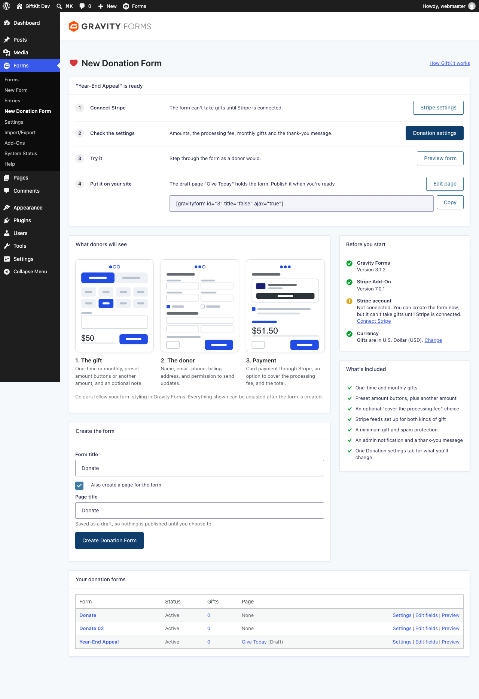
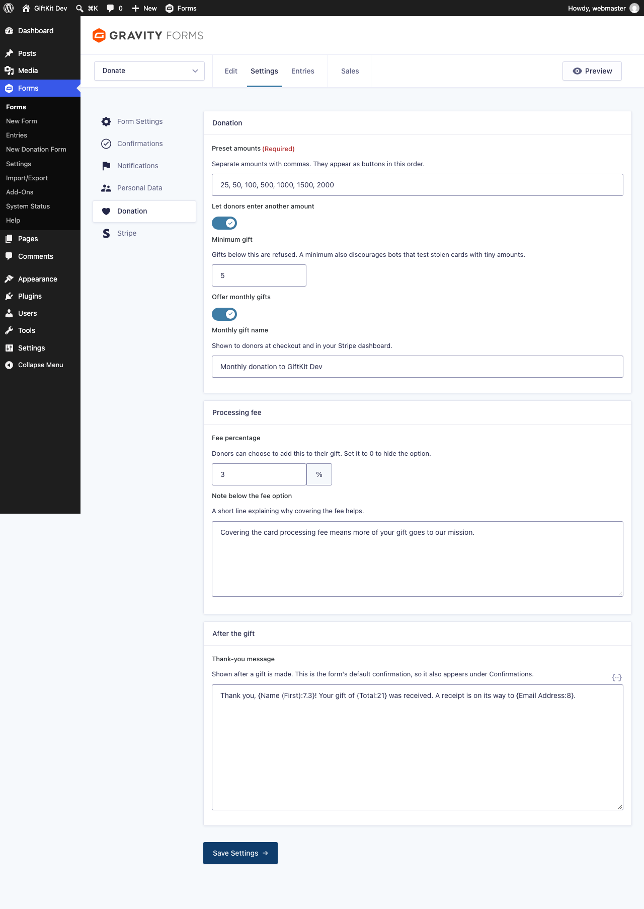
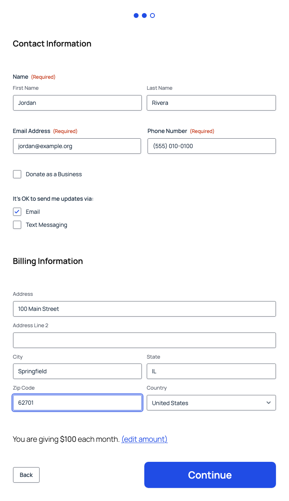

# GiftKit for Gravity Forms #
**Contributors:** [TheWebist](https://profiles.wordpress.org/TheWebist/)  
**Tags:** donations, donation form, gravity forms, stripe, nonprofit  
**Requires at least:** 6.5  
**Tested up to:** 7.1  
**Requires PHP:** 8.1  
**Stable tag:** 0.1.0  
**License:** GPL2+  
**License URI:** https://www.gnu.org/licenses/gpl-2.0.html  

A ready-made donation form for Gravity Forms, with one-time and monthly gifts, preset amounts, an optional processing fee and Stripe payments.

## Description ##

Building a good donation form in Gravity Forms takes a lot of setup: pages, pricing fields, conditional logic, two Stripe feeds, and styling that makes it feel like giving rather than filling in a form. GiftKit does all of that in one step, then keeps the handful of settings you'll actually change on a single **Donation** tab.

**What donors get**

* A three-page form: the gift, the donor's details, then payment
* One-time or monthly gifts, chosen with a clear toggle
* Preset amount buttons, plus their own amount if you allow it
* An optional "cover the processing fee" choice
* A summary of their gift before they pay, and a total that says whether it's charged once or every month
* Card payments through Stripe, including Link

**What you get**

* Forms → New Donation Form creates the form, both Stripe feeds and, if you like, a draft page to hold it
* A Donation settings tab for the preset amounts, minimum gift, monthly gifts, the fee and its note, and the thank-you message
* A minimum gift, which also discourages bots that test stolen cards with tiny amounts
* Everything else stays ordinary Gravity Forms: entries, notifications, confirmations and add-ons all work as usual

GiftKit is built on Gravity Forms' own fields, pricing and the official Stripe Add-On, so payments, subscriptions and receipts are handled by tools you already trust. Its colours follow the form's Gravity Forms styling, and amounts use your Gravity Forms currency.

**Requirements**

* [Gravity Forms](https://www.gravityforms.com/) 2.9 or later
* The [Gravity Forms Stripe Add-On](https://www.gravityforms.com/add-ons/stripe/), connected to your Stripe account

GiftKit isn't affiliated with or endorsed by Gravity Forms or Stripe.

## Installation ##

1. Install and activate Gravity Forms and the Gravity Forms Stripe Add-On, and connect Stripe under Forms → Settings → Stripe.
2. Install and activate GiftKit.
3. Go to Forms → New Donation Form, give the form a title, and create it.
4. Adjust the form's Donation settings, then publish the page that holds it (or add the form to any page with the Gravity Forms block or shortcode).

## Frequently Asked Questions ##

### Do I need the Gravity Forms Stripe Add-On? ###

Yes. GiftKit takes payments through it, and sets up its feeds for you.

### Can I change the fields? ###

Yes. A GiftKit form is a normal Gravity Forms form, so you can edit labels, add fields or reorder them in the form editor. GiftKit finds the fields it manages by role rather than position, so its settings keep working.

### How do I test it without real charges? ###

Put the Stripe Add-On in test mode and use Stripe's test card numbers. The New Donation Form page shows whether Stripe is in test or live mode.

### Can I turn off monthly gifts or the processing fee? ###

Yes. Turn off "Offer monthly gifts" on the Donation tab, or set the fee percentage to 0.

### Which currencies work? ###

Whichever currency Gravity Forms is set to. Amounts and totals use its symbol and formatting.

## Screenshots ##

### 1. Forms → New Donation Form: what donors will see, whether your site is ready, and your donation forms. ###

### 2. The Donation settings tab: amounts, monthly gifts, the processing fee and the thank-you message. ###

### 3. Page 1 of the form: one-time or monthly, preset amounts, and a note. ###

### 4. Page 2: the donor's details, with a summary of their gift. ###

## Changelog ##

### 0.1.0 ###
* Initial development release.

## Upgrade Notice ##

### 0.1.0 ###
Initial development release.
